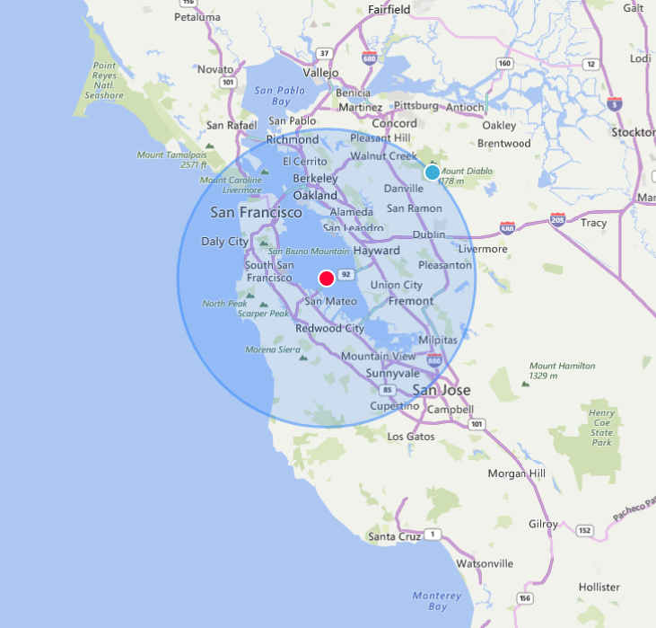

# @sfearthquakealerts


Follow my [Threads profile](https://www.threads.net/@sfearthquakealerts)!

# Overview

`fetch_and_post_earthquake.py` is run via a cron job on Dreamhost that is scheduled to run every 5 minutes.

`fetch_new_earthquakes()` gets the latest data from the USGS API. The script monitors earthquakes within a 300-mile radius and filters them based on distance and magnitude:

- Within 25 miles: Reports ALL earthquakes
- 25-50 miles: Reports earthquakes M2.0 and above
- 50-100 miles: Reports earthquakes M4.0 and above
- 100-200 miles: Reports earthquakes M5.0 and above
- 200-300 miles: Reports earthquakes M7.0 and above

25 mile radius:
<br />


`post_to_threads()` takes the earthquake data and calls the threads API to publish a post. I include the USGS link to the earthquake details plus a google maps link to the coordinates of the earthquake epicenter.

`th_access_token.sh` (a wrapper around `th_access_token.py`) runs as a **daily** cron job to keep the Threads access token valid. Long-lived tokens last 60 days and can only be refreshed while still valid, so it refreshes about once a day (it skips if it already refreshed in the last 20h, or if the token was pasted in less than 24h ago). The refreshed token is written back to `.env.local` and its expiry goes to `.token_state.json`. Any failure exits 1 and is recorded in `.cron_status.token` so the cron watchdog alerts, and every run is logged to `th_access_token.log`. After repairing the server or venv, run `./th_access_token.sh --force` once to refresh right away.

If the token has already expired it can't be refreshed. Generate a new long-lived token and replace `THREADS_ACCESS_TOKEN` in `.env.local`.

# Instructions

1. **Clone the repository:**

   ```bash
   git clone https://github.com/0xjessel/earthquake-bot.git
   cd earthquake-bot
   ```

2. **Create a virtual environment:**

   ```bash
   python -m venv venv
   ```

3. **Activate the virtual environment:**

   - On Windows:
     ```bash
     venv\Scripts\activate
     ```
   - On macOS/Linux:
     ```bash
     source venv/bin/activate
     ```

4. **Install the required packages:**

   ```bash
   pip install -r requirements.txt
   ```

5. **Create a `.env.local` file:**

   - Copy the `.env.example` file to create your own environment configuration:
     ```bash
     cp .env.example .env.local
     ```

6. **Edit the `.env.local` file:**

   - Open `.env.local` in a text editor and fill in the required values

7. **Run the script**

```bash
python fetch_and_post_earthquake.py
```

8. To update the cron job on dreamhost server

```bash
scp fetch_and_post_earthquake.py meltedxice@iad1-shared-b8-41.dreamhost.com:~/cron_jobs/ba-earthquake-bot/
```

9. Update the .env.local file if it changed

# Random thoughts

What other bots can I make hmm..
